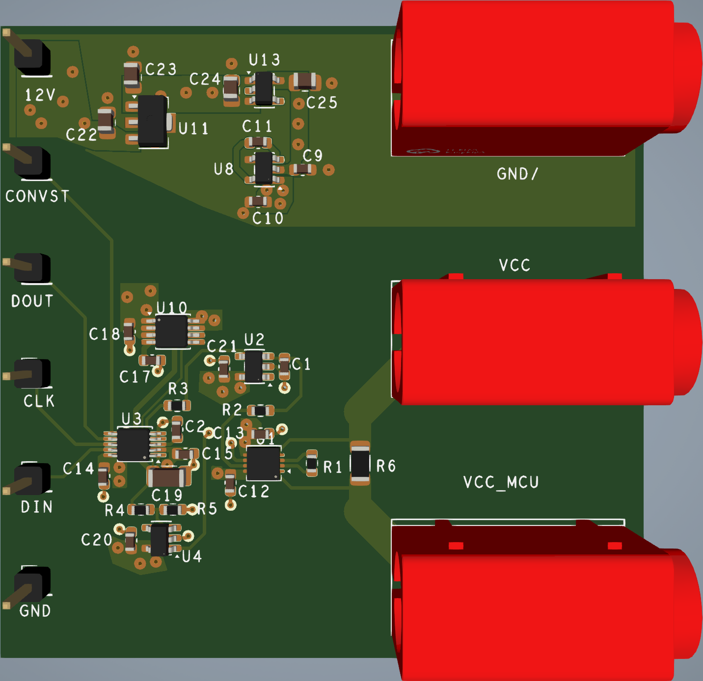
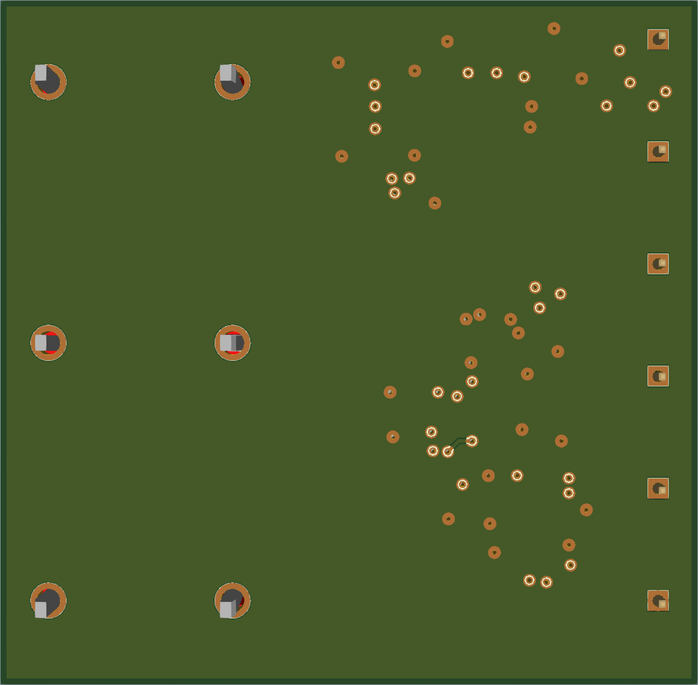
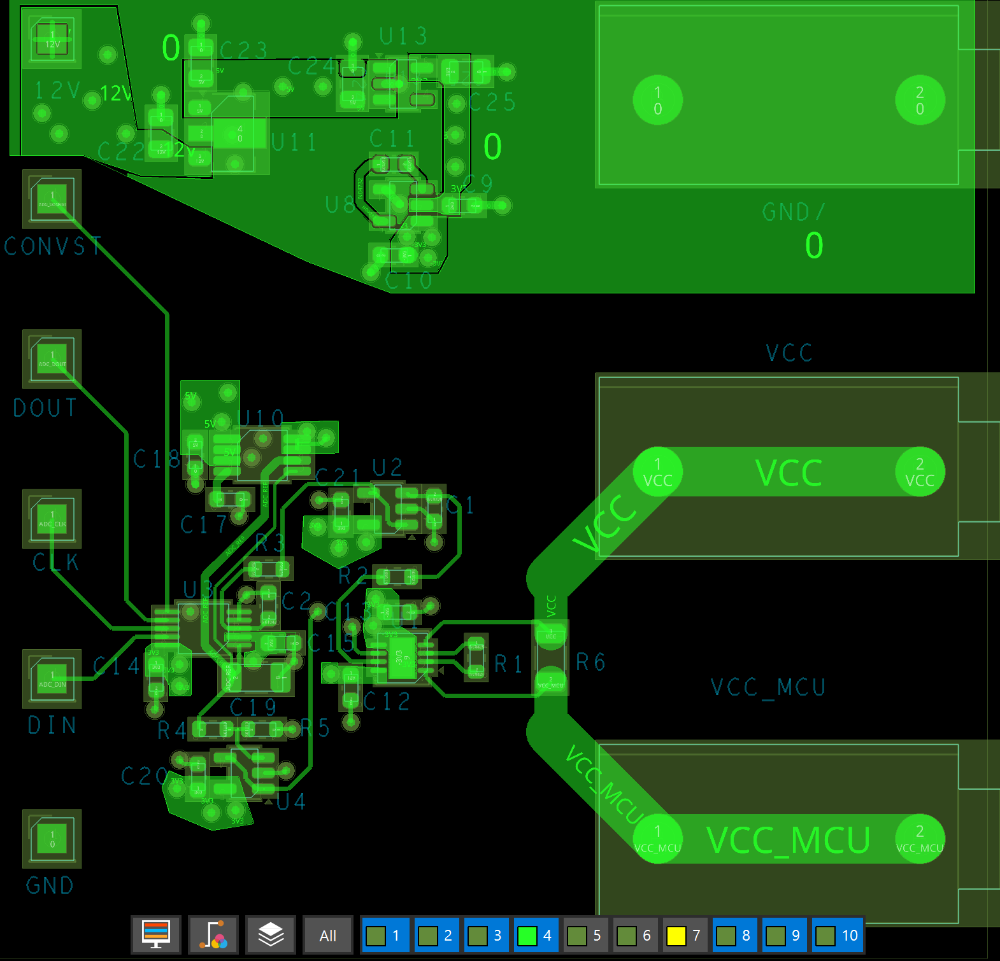
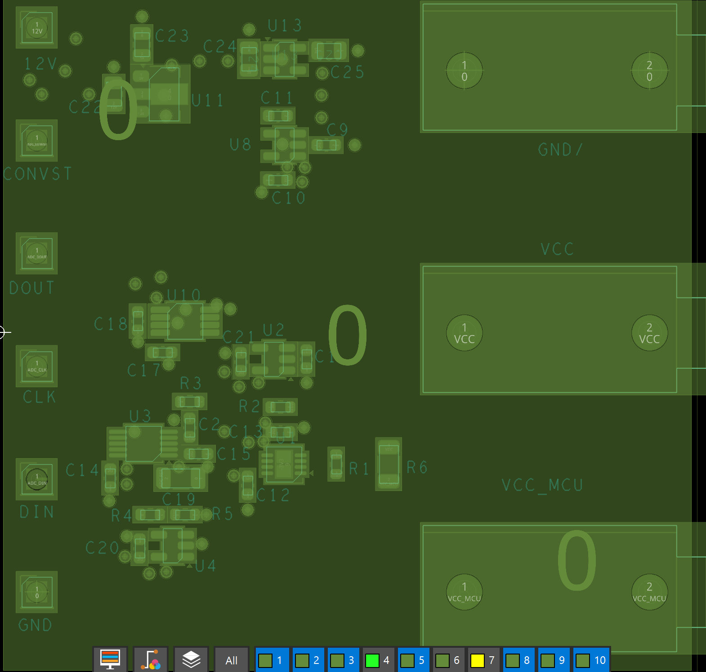
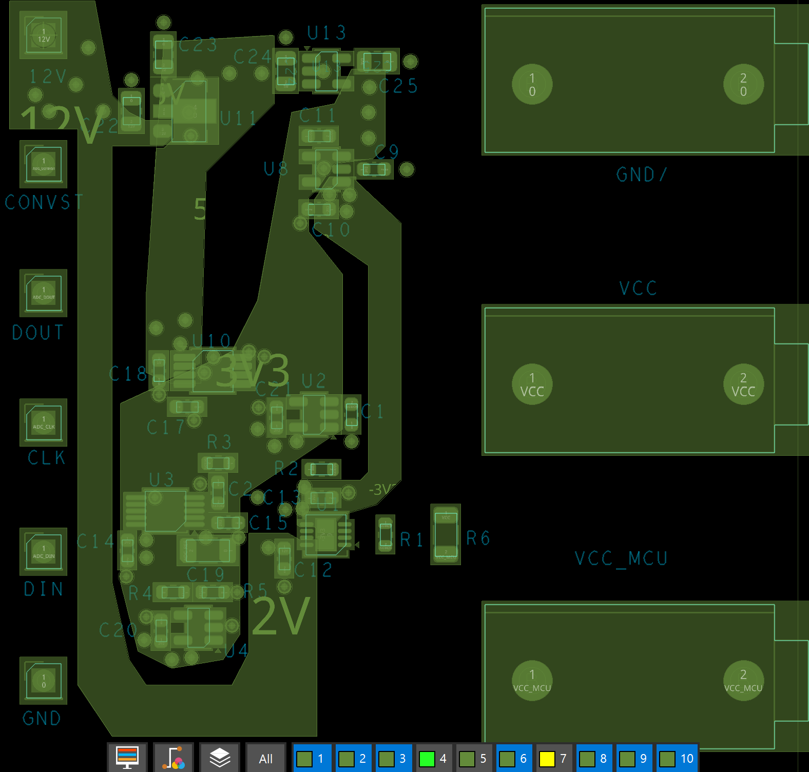
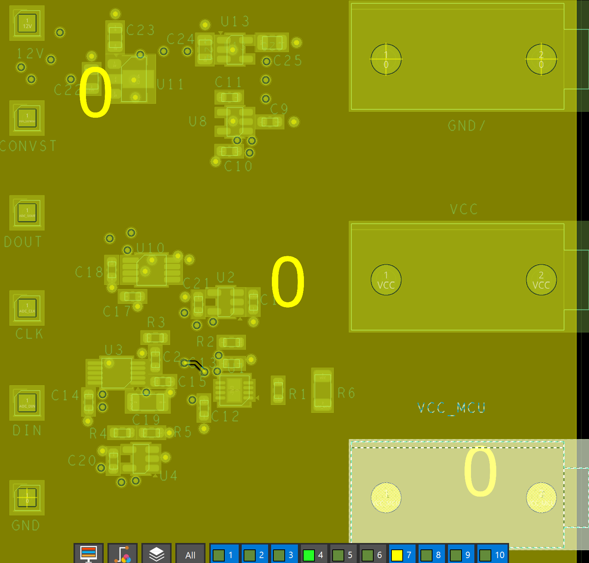
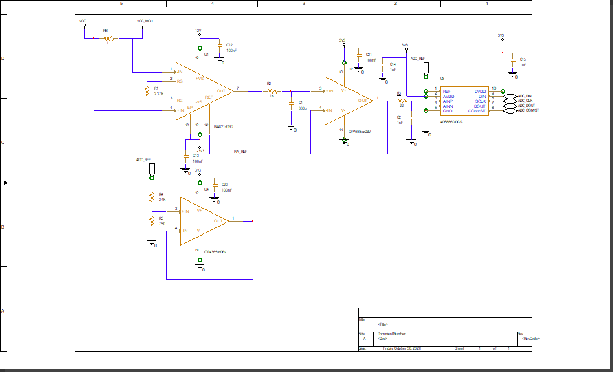
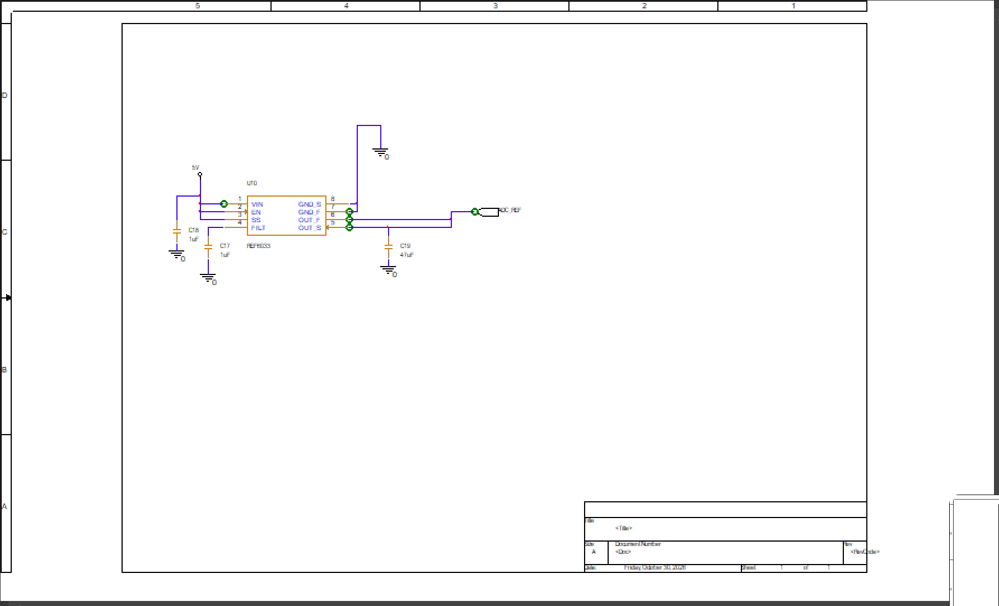
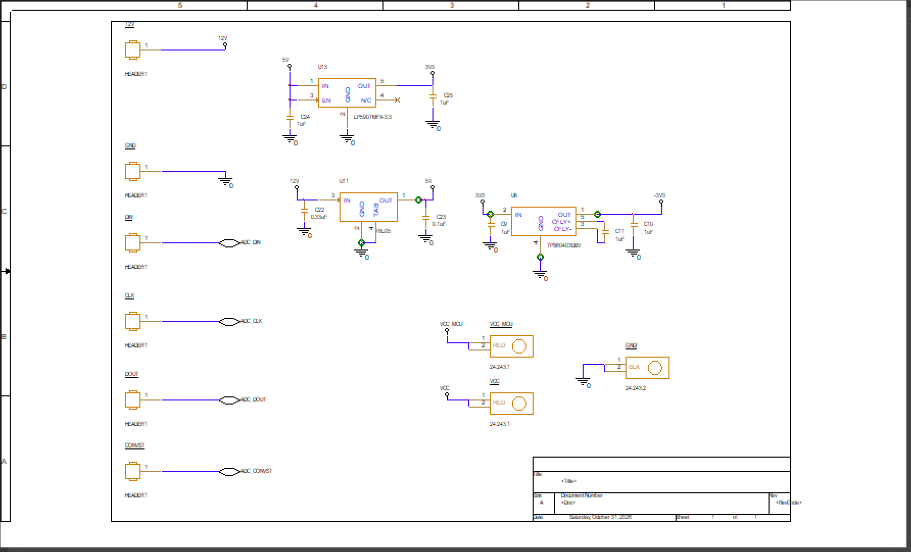

# Current-sensing-circuit
4-layer MCU supply-current monitor: 1 Ω 0.1% shunt → INA821 in-amp → OPA365 driver → 16-bit 1 MSPS ADS8860 ADC with a REF6033 reference. 12 V input. OrCAD X 24.1 schematic and PCB, with JLCPCB-ready Gerbers and an LCSC BOM.

## PCB

| 3D top | 3D bottom |
|---|---|
|  |  |

59.35 × 58.42 mm, 4 layers, 1.6 mm.

| L1 Top | L2 GND plane |
|---|---|
|  |  |

| L3 Power (12V, 5V, 3V3, −3V3) | L4 Bottom (GND) |
|---|---|
|  |  |

## Schematic

**Signal chain:** shunt, INA821, OPA365 filter/driver and ADS8860 ADC

**ADC reference:** REF6033

**Power and connectors:** 78L05, LP5907, TPS60403, headers and banana sockets

